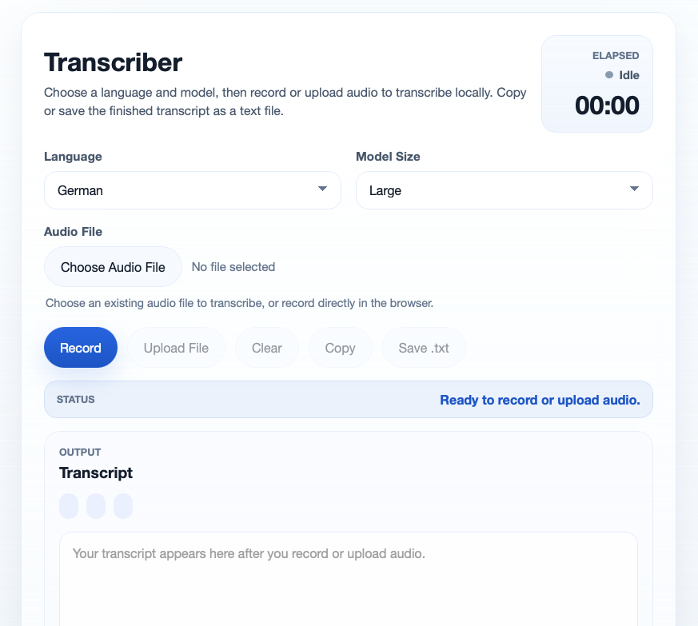

# Transcriber

[](https://github.com/rnckp/transcriber)
[](https://fastapi.tiangolo.com/)
[](https://developer.mozilla.org/docs/Web/HTML)
[](https://www.apple.com/mac/)

[](https://github.com/rnckp/transcriber/stargazers)
<a href="https://github.com/astral-sh/ruff"></a>

Local browser-based transcription app for Apple Silicon Macs. It serves a FastAPI backend and vanilla HTML/CSS/JS frontend, then transcribes audio locally with MLX Whisper, NVIDIA Parakeet on MLX, Cohere Transcribe on ONNX Runtime/Core ML, or the optional Microsoft VibeVoice ASR backend for diarized output.



## Requirements

- macOS on Apple Silicon
- Python 3.12+
- `uv`
- For `vibevoice-7b`: enough memory for the 7B ASR model; browser `.webm` recordings also need the `ffmpeg` command available on `PATH` for audio decoding

## Setup

```bash
uv sync
```

The VibeVoice ASR source needed by this app is vendored in `vibevoice/` under the upstream MIT license, so no second VibeVoice checkout is required.

## Run

```bash
uv run python -m app.main
```

Open `http://127.0.0.1:8000`.

Choose a language and model, then either record from the browser microphone or choose an audio file. The UI shows upload and transcription progress, result metadata, and lets you copy or save the transcript as `.txt`.

## Models

Configured model options live in `config.yaml`:

- `tiny`, `base`, `small`, `medium`: progressively larger multilingual Whisper models optimized for Apple Silicon through MLX
- `large` (Large v3 Turbo), `large-v2`, and `large-v3`: higher-accuracy multilingual MLX Whisper options
- `distil-large-v3-en`: a faster English-only Distil-Whisper model; selecting it limits the language picker to English
- `parakeet-v3`: NVIDIA Parakeet TDT 0.6B V3, converted to MLX for fast multilingual transcription on Apple Silicon
- `parakeet-v2-en`: the English-only NVIDIA Parakeet TDT 0.6B V2 MLX checkpoint
- `cohere-transcribe-int8`: Cohere Transcribe 03-2026 using the approximately 2.7 GB INT8 ONNX export and Core ML acceleration when available
- `vibevoice-7b`: VibeVoice ASR with speaker segments, loaded through the local vendored VibeVoice package

Models download on first use and remain cached on disk. Consecutive runs with the same backend reuse the loaded model in memory. Switching between backend families automatically unloads the previous backend to protect Apple unified memory, so the first run after switching back must reload that model. Parakeet uses MLX/Metal; Cohere prefers ONNX Runtime's Core ML execution provider and, in `auto` mode, retries on its optimized ARM CPU provider if Core ML cannot execute the model. VibeVoice also downloads its Hugging Face model on first real use and can require substantial memory; keep `transcription.vibevoice_max_new_tokens` conservative unless you know the target machine can handle more.

## API

`POST /api/transcriptions`

Multipart form fields:

- `audio`: audio file or browser recording
- `language`: configured language code, currently `de` or `en`
- `model_size`: configured model id, for example `small`, `large`, or `vibevoice-7b`

Successful response:

```json
{
  "transcript": "Text...",
  "language": "de",
  "model_size": "small",
  "duration_seconds": 12.3,
  "segments": []
}
```

Error response:

```json
{
  "error": {
    "code": "unsupported_language",
    "message": "Choose German or English."
  }
}
```

Invalid requests return `400`, oversized uploads return `413`, and transcription failures return `500`.

## Configuration

Edit `config.yaml` for runtime settings:

- `transcription.cache_dir`: local model cache directory
- `transcription.max_upload_size_mb`: upload size limit
- `transcription.upload_chunk_size_mb`: temp-file streaming chunk size
- `transcription.supported_languages`: language picker and backend validation
- `transcription.supported_model_sizes`: model picker, repo ids, backend routing, and optional per-model `language_codes`
- `transcription.parakeet_*`: long-audio chunk and overlap durations for Parakeet
- `transcription.cohere_max_new_tokens`: Cohere decoder limit, capped by the exported model's 1024-token context
- `transcription.cohere_execution_provider`: `auto`, `coreml`, or `cpu`; `auto` prefers Core ML on macOS
- `transcription.vibevoice_*`: VibeVoice device, dtype, attention mode, and generation settings
- `logging.level`: structured JSON log level
- `ui.*`: browser labels, status messages, and progress timing heuristics

`server.host` and `server.port` control the bind address used by `uv run python -m app.main`.

## Development

```bash
uv run ruff format .
uv run ruff check .
uv run pytest -v
```

Project layout:

- `app/main.py`: FastAPI app, config loading, frontend template rendering
- `app/api/`: transcription API
- `app/services/`: backend routing, `mlx-whisper`, and VibeVoice integration
- `app/static/`: browser UI
- `tests/`: API, config, and service tests
- `vibevoice/`: vendored VibeVoice ASR model and processor code from Microsoft VibeVoice, MIT licensed

## License

MIT License. Vendored VibeVoice code under `vibevoice/` is also MIT licensed; see `vibevoice/LICENSE`.
